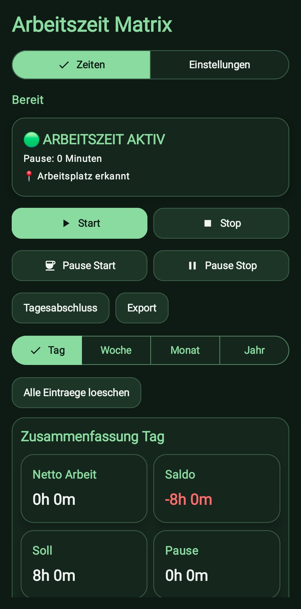
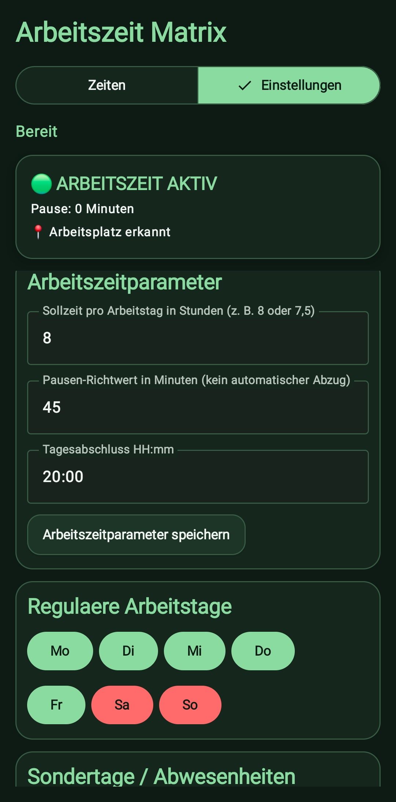
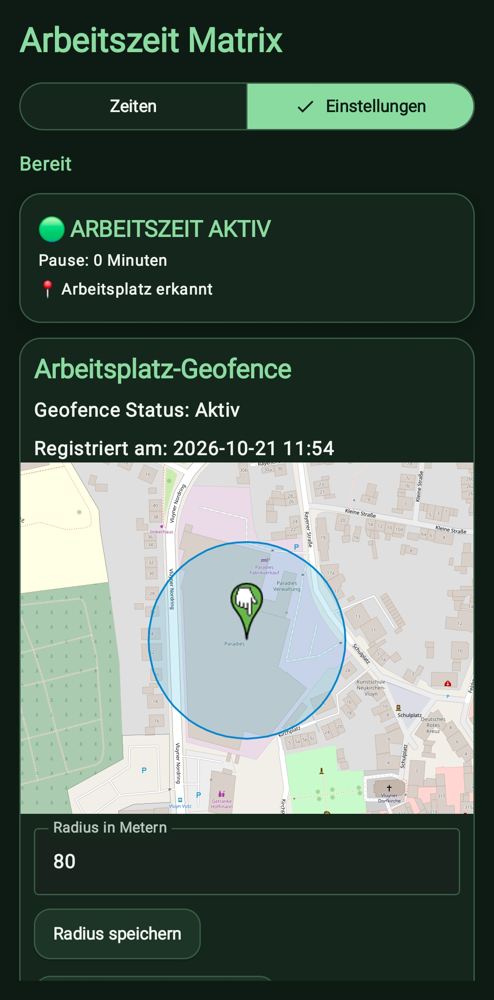

# Arbeitszeit Geofence

Android-App zur lokalen Arbeitszeiterfassung mit Arbeitsplatz-Geofence. Open Source unter der [MIT-Lizenz](LICENSE), Nutzung ohne Gewähr (siehe [Lizenz und Haftungsausschluss](#lizenz-und-haftungsausschluss--license-and-disclaimer)).

> **Letzter Release:** [`v1.6.0`](https://github.com/tazzy0703-stack/Android-Worktime-Tracker/releases/tag/v1.6.0)
> **Plattform:** Android 14 oder neuer (minSdk 34)
> **Distribution:** APK über GitHub Releases
> **Projektstatus:** abgeschlossen, keine Weiterentwicklung (siehe [Projektstatus](#projektstatus--project-status))

## Projektstatus / Project status

**Deutsch:** Dieses Projekt ist **abgeschlossen**. Die App deckt meinen Bedarf vollständig ab, ich entwickle sie nicht weiter und pflege sie nicht. Es gibt keinen Support, und Issues und Pull Requests werden nicht bearbeitet. Wer die App braucht oder anpassen möchte, kann sie unter den Bedingungen der [MIT-Lizenz](LICENSE) frei nutzen, **forken** und auf eigene Verantwortung selbst weiterentwickeln.

**English:** This project is **finished**. The app covers my needs completely; I will not develop or maintain it further. There is no support, and issues and pull requests will not be handled. Anyone who needs or wants to change it may use it freely under the [MIT License](LICENSE), **fork** it and continue at their own risk.

## Funktionen

- Arbeitszeit automatisch beim Betreten und Verlassen eines konfigurierbaren Arbeitsplatz-Geofence starten bzw. beenden
- Kurzes Verlassen und Zurückkehren innerhalb von 5 Minuten setzt den letzten automatisch beendeten Block fort, statt einen neuen Eintrag anzulegen
- Anwesenheitsabgleich beim Öffnen der App: Befindest du dich bereits am Arbeitsplatz und die Zeit läuft nicht, wird sie gestartet (nicht nach manuellem Stop oder Tagesabschluss)
- Manuelles Starten, Stoppen und Erfassen von Pausen; dauerhafte Statusbenachrichtigung
- Manueller und automatischer Tagesabschluss
- Tages-, Wochen-, Monats- und Jahresauswertung mit Netto-Arbeit, Soll, Pause und Saldo; bezahlte Abwesenheit wird als Zusatzzeile gezeigt
- Das Soll zählt nur bis einschließlich heute, damit erarbeitete Überstunden im Saldo sichtbar werden; künftige Tage werden als „geplant“ gekennzeichnet
- Tagessoll in Stunden eingeben; individuelle Arbeitstage bestimmen Wochen- und Periodensoll
- Urlaub, Feiertag und Krankheit werden an geplanten Arbeitstagen mit Sollzeit gutgeschrieben; „Frei“ erzeugt keine Gutschrift
- Pausen werden nur manuell erfasst und abgezogen; der Pausen-Richtwert wird nicht automatisch verwendet
- Arbeitszeiteinträge bearbeiten, löschen und als CSV exportieren
- Arbeitsplatz auf einer OpenStreetMap-Karte festlegen und Geofence-Radius konfigurieren
- „Aktuelle Position speichern“ nutzt eine frische Hochpräzisions-Ortung; bei einer Genauigkeit schlechter als 100 m wird abgebrochen, ab 50 m erscheint ein Hinweis
- Nach Änderung von Arbeitsplatz oder Radius wird ein zuvor aktiver Geofence automatisch neu registriert
- Geofence-Wiederherstellung nach Geräte-Neustart und App-Update; schlägt sie fehl, wird sie im Hintergrund mit Wartezeit mehrfach wiederholt

## Screenshots

### Dashboard



### Zeiterfassung



### Einstellungen



## Änderungen gegenüber v1.5.0

Version 1.6.0:

- **Tagesabschluss:** Datum und Endzeit richten sich nach dem geplanten Abschlusszeitpunkt. Läuft der Hintergrundjob verzögert (Energiesparmodus, nach Mitternacht), wird nicht mehr der Folgetag abgeschlossen.
- **Hintergrunddienst:** Aktionen laufen nacheinander und sind gegen fehlende Standortberechtigung und Hintergrundstart-Beschränkungen abgesichert; Eintrag und Zustand werden gemeinsam gespeichert.
- **Geofence:** keine unnötige Neuregistrierung bei jedem App-Start, Wiederholung der Wiederherstellung mit Backoff, Anwesenheitsabgleich beim Öffnen der App.
- **Sicherheit/Konfiguration:** der Wiederherstellungs-Receiver ist nicht mehr exportiert; das Room-Schema wird exportiert (`app/schemas`), damit künftige Datenbankänderungen migrierbar sind.
- **Oberfläche:** einheitliches 2×2-Raster der Kennzahlen, die Karte „Gutschrift-Tage“ entfällt, Dashboard-Schriften sind kleiner, die Quellenangabe „© OpenStreetMap contributors“ wird wieder auf der Karte angezeigt.

Die Änderungen sind per Build und Unit-Tests geprüft. Das Verhalten am Gerät (Verlassen/Betreten, Neustart) wurde vom Autor im Alltag getestet; der Tagesabschluss über Mitternacht und die Randfälle der Wiederaufnahme sind nicht gesondert abgesichert.

## Installation

Die APK des letzten veröffentlichten Releases findest du unter [GitHub Releases](https://github.com/tazzy0703-stack/Android-Worktime-Tracker/releases). Lade das APK-Asset herunter und installiere es auf dem Smartphone. Android kann die einmalige Freigabe zur Installation aus dieser Quelle verlangen.

Für automatische Geofence-Erkennung müssen Standortdienste und präziser Standort aktiviert sein. Stelle in den Android-App-Berechtigungen den Standortzugriff auf **„Immer zulassen“** und erlaube Benachrichtigungen. Lege anschließend Arbeitsplatz und Radius fest und registriere den Geofence in der App. Android und herstellerspezifische Akku-Optimierungen können Hintergrundereignisse verzögern; eine sekundengenaue Erkennung ist nicht garantiert. Für zuverlässige Ergebnisse empfiehlt sich ein Radius von mindestens 100 m und die Ausnahme der App von der Akku-Optimierung. Der Anwesenheitsabgleich beim App-Start wertet nur Ortungen mit einer Genauigkeit von höchstens 100 m aus.

## Build über GitHub Actions

Der Workflow **Android APK** startet bei Pushes auf `main` und auf `fix/**`-Branches, bei Pull Requests gegen `main` und kann auch manuell ausgeführt werden. Er führt die Unit-Tests aus und stellt eine Debug-APK (Artifact `ArbeitszeitGeofence-debug-apk`) bereit. Die signierte Release-APK (Artifact `ArbeitszeitGeofence-release-apk`) wird nur erstellt, wenn die Repository-Secrets für die Android-Release-Signierung eingerichtet sind. Nur sie ist mit dem Release-Schlüssel signiert und lässt sich als Update über eine installierte Version einspielen. Die Debug-APK hat eine eigene App-ID (`.debug`) und läuft als separate App neben der Release-Version.

Für einen manuellen Lauf: Repository → **Actions** → **Android APK** → **Run workflow** → Branch auswählen → **Run workflow**. Nach erfolgreichem Lauf das gewünschte APK aus **Artifacts** herunterladen.

## Technische Basis

Kotlin, Jetpack Compose, Room, Google Play Services Geofencing, Android Foreground Service, WorkManager und OpenStreetMap/osmdroid.

## Datenschutz

Arbeitszeit- und Planungseinträge werden lokal auf dem Gerät gespeichert. Es gibt kein Benutzerkonto und keine Übertragung von Arbeitszeit- oder Standortdaten an einen Server des Autors. Für die Kartenansicht werden OpenStreetMap-Kacheln über das Internet geladen; Kartendaten © [OpenStreetMap-Mitwirkende](https://www.openstreetmap.org/copyright) (ODbL).

## Lizenz und Haftungsausschluss / License and Disclaimer

Dieses Projekt steht unter der [MIT-Lizenz](LICENSE). / This project is licensed under the [MIT License](LICENSE).

### Deutsch (unverbindliche Übersetzung)

Copyright (c) 2026 Kai Becker

Die Software wird unter der MIT-Lizenz bereitgestellt. Maßgeblich ist ausschließlich der englische Originaltext in der Datei [LICENSE](LICENSE); die folgende Übersetzung dient nur dem Verständnis.

**Die Software wird „WIE BESEHEN“ (AS IS) bereitgestellt, ohne jegliche ausdrückliche oder stillschweigende Gewährleistung, einschließlich, aber nicht beschränkt auf die Gewährleistung der Marktgängigkeit, der Eignung für einen bestimmten Zweck und der Nichtverletzung von Rechten Dritter. In keinem Fall haften die Autoren oder Urheberrechtsinhaber für Ansprüche, Schäden oder sonstige Haftung, sei es aus Vertrag, unerlaubter Handlung oder anderweitig, die sich aus der Software, ihrer Nutzung oder sonstigem Umgang mit ihr ergeben oder damit in Zusammenhang stehen.**

Die Nutzung erfolgt auf eigene Verantwortung. Insbesondere übernimmt der Autor keine Gewähr für die Richtigkeit, Vollständigkeit oder Rechtsverbindlichkeit der erfassten Arbeitszeiten; die App ersetzt keinen gesetzlichen oder betrieblichen Arbeitszeitnachweis. Die automatische Erkennung über Geofences kann ausfallen oder sich verzögern (siehe Hinweise zur Installation). Soweit zwingendes Recht eine Haftung vorschreibt, bleibt diese unberührt.

### English

Copyright (c) 2026 Kai Becker

Permission is hereby granted, free of charge, to any person obtaining a copy of this software and associated documentation files (the "Software"), to deal in the Software without restriction, including without limitation the rights to use, copy, modify, merge, publish, distribute, sublicense, and/or sell copies of the Software, subject to the conditions in the [LICENSE](LICENSE) file.

```text
THE SOFTWARE IS PROVIDED "AS IS", WITHOUT WARRANTY OF ANY KIND, EXPRESS OR
IMPLIED, INCLUDING BUT NOT LIMITED TO THE WARRANTIES OF MERCHANTABILITY,
FITNESS FOR A PARTICULAR PURPOSE AND NONINFRINGEMENT. IN NO EVENT SHALL THE
AUTHORS OR COPYRIGHT HOLDERS BE LIABLE FOR ANY CLAIM, DAMAGES OR OTHER
LIABILITY, WHETHER IN AN ACTION OF CONTRACT, TORT OR OTHERWISE, ARISING FROM,
OUT OF OR IN CONNECTION WITH THE SOFTWARE OR THE USE OR OTHER DEALINGS IN THE
SOFTWARE.
```

Use at your own risk. The author makes no guarantee that recorded working times are correct, complete or legally binding; the app is not a substitute for any statutory or company time record. Geofence-based detection may fail or be delayed.
